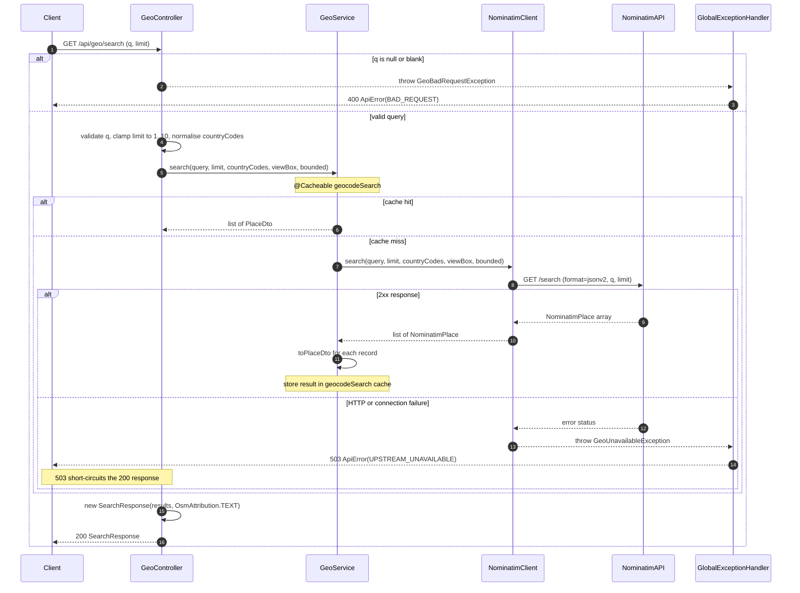
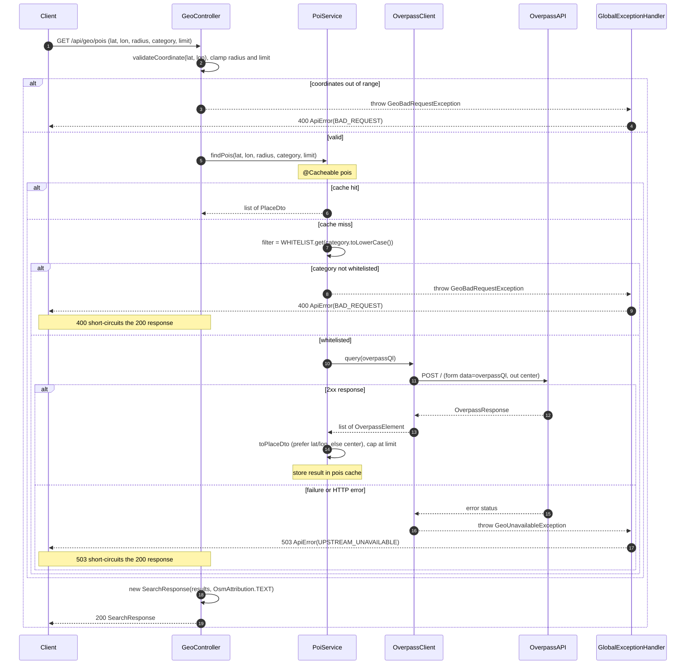
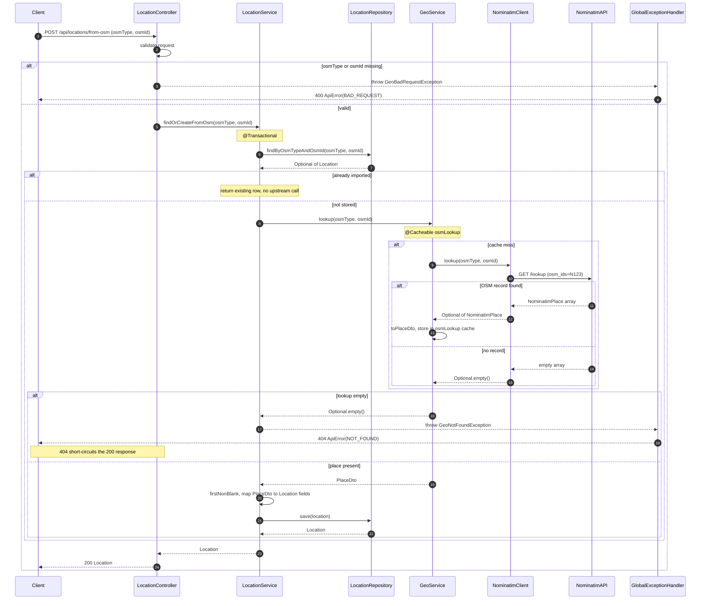

# OSM backend integration (branch `openstreetmaps`)

UML documentation for the OpenStreetMap (OSM) backend integration.

The diagrams below are [Mermaid](https://mermaid.js.org/) code blocks: they render on GitHub and
with `mermaid-cli` (`mmdc`). **Scope:** only the OSM integration — the `config` cache/HTTP-client
beans, the `geo` package (Nominatim + Overpass clients, services, DTOs, exceptions), and the
OSM-related parts of the `trips` package and the global exception handler. Non-OSM trip/activity/user
code is intentionally out of scope.

> Namespace identifiers use underscores (`geo_dto`, `geo_nominatim`, `geo_overpass`) instead of dots
> because a dotted Mermaid namespace id is not guaranteed to parse on every renderer. Each block is
> prefixed with the real Java package it represents.

---

## 1. Class diagram

```mermaid
classDiagram
    direction LR

    %% Java package: com.smu.cs203_g1_1.itinerary_planner.config
    namespace config {
        class CacheConfig {
            <<configuration>>
            +GEOCODE_SEARCH : String
            +GEOCODE_REVERSE : String
            +OSM_LOOKUP : String
            +POIS : String
            +cacheManager() : CacheManager
            -placeCache() : Cache
        }
        class OsmClientConfig {
            <<configuration>>
            +nominatimRestClient(baseUrl : String, userAgent : String, connectTimeout : Duration, readTimeout : Duration) : RestClient
            +overpassRestClient(baseUrl : String, userAgent : String, connectTimeout : Duration, readTimeout : Duration) : RestClient
            -buildClient(baseUrl : String, userAgent : String, connectTimeout : Duration, readTimeout : Duration) : RestClient
        }
        class nominatimRestClient {
            <<bean>>
            +type : RestClient
            +baseUrl : String
            +userAgent : String
        }
        class overpassRestClient {
            <<bean>>
            +type : RestClient
            +baseUrl : String
            +userAgent : String
        }
    }

    %% Java package: com.smu.cs203_g1_1.itinerary_planner.geo
    namespace geo {
        class GeoController {
            <<restController>>
            -geoService : GeoService
            -poiService : PoiService
            +search(q : String, limit : int, countryCodes : String, viewBox : String, bounded : boolean) : SearchResponse
            +reverse(lat : double, lon : double, zoom : int) : SinglePlaceResponse
            +pois(lat : double, lon : double, radius : int, category : String, limit : int) : SearchResponse
            -validateCoordinate(lat : double, lon : double) : void
        }
        class GeoService {
            <<service>>
            -nominatimClient : NominatimClient
            +search(query : String, limit : int, countryCodes : String, viewBox : String, bounded : boolean) : List~PlaceDto~
            +reverse(lat : double, lon : double, zoom : int) : PlaceDto
            +lookup(osmType : String, osmId : long) : Optional~PlaceDto~
            -toPlaceDto(place : NominatimPlace) : PlaceDto
            -toAddressDto(address : NominatimAddress) : AddressDto
            -openingHours(place : NominatimPlace) : String
            -toBoundingBoxDto(boundingbox : List~String~) : BoundingBoxDto
            -parseDouble(value : String) : double
            -firstNonBlank(values : String...) : String
        }
        class PoiService {
            <<service>>
            -CATEGORY_TAG_KEYS : List~String~
            -WHITELIST : Map~String,TagFilter~
            -overpassClient : OverpassClient
            +findPois(lat : double, lon : double, radius : int, category : String, limit : int) : List~PlaceDto~
            -toPlaceDto(element : OverpassElement) : PlaceDto
            -joinNonBlank(values : String...) : String
        }
        class TagFilter {
            <<record>>
            -key : String
            -value : String
        }
        class NominatimClient {
            <<component>>
            -restClient : RestClient
            +search(query : String, limit : int, countryCodes : String, viewBox : String, bounded : boolean) : List~NominatimPlace~
            +reverse(lat : double, lon : double, zoom : int) : Optional~NominatimPlace~
            +lookup(osmType : String, osmId : long) : Optional~NominatimPlace~
        }
        class OverpassClient {
            <<component>>
            -log : Logger
            -restClient : RestClient
            +query(overpassQl : String) : List~OverpassElement~
        }
        class OsmAttribution {
            +TEXT : String
            +URL : String
        }
        class GeoBadRequestException {
            <<exception>>
            +GeoBadRequestException(message : String)
        }
        class GeoNotFoundException {
            <<exception>>
            +GeoNotFoundException(message : String)
        }
        class GeoUnavailableException {
            <<exception>>
            +GeoUnavailableException(message : String)
        }
        class ApiError {
            <<record>>
            +error : String
            +message : String
        }
    }

    %% Java package: com.smu.cs203_g1_1.itinerary_planner.geo.dto
    namespace geo_dto {
        class PlaceDto {
            <<record>>
            +osmType : String
            +osmId : Long
            +name : String
            +displayName : String
            +category : String
            +type : String
            +latitude : double
            +longitude : double
            +address : AddressDto
            +openingHours : String
            +boundingBox : BoundingBoxDto
            +importance : Double
        }
        class AddressDto {
            <<record>>
            +houseNumber : String
            +road : String
            +city : String
            +state : String
            +postcode : String
            +country : String
            +countryCode : String
        }
        class BoundingBoxDto {
            <<record>>
            +minLat : double
            +minLon : double
            +maxLat : double
            +maxLon : double
        }
        class SearchResponse {
            <<record>>
            +results : List~PlaceDto~
            +attribution : String
        }
        class SinglePlaceResponse {
            <<record>>
            +result : PlaceDto
            +attribution : String
        }
    }

    %% Java package: com.smu.cs203_g1_1.itinerary_planner.geo.nominatim
    namespace geo_nominatim {
        class NominatimPlace {
            <<record>>
            +osmType : String
            +osmId : Long
            +lat : String
            +lon : String
            +category : String
            +type : String
            +name : String
            +displayName : String
            +importance : Double
            +boundingbox : List~String~
            +address : NominatimAddress
            +extratags : Map~String,String~
        }
        class NominatimAddress {
            <<record>>
            +houseNumber : String
            +road : String
            +city : String
            +town : String
            +village : String
            +state : String
            +postcode : String
            +country : String
            +countryCode : String
        }
    }

    %% Java package: com.smu.cs203_g1_1.itinerary_planner.geo.overpass
    namespace geo_overpass {
        class OverpassResponse {
            <<record>>
            +elements : List~OverpassElement~
        }
        class OverpassElement {
            <<record>>
            +type : String
            +id : Long
            +lat : Double
            +lon : Double
            +center : OverpassCenter
            +tags : Map~String,String~
        }
        class OverpassCenter {
            <<record>>
            +lat : Double
            +lon : Double
        }
    }

    %% Java package: com.smu.cs203_g1_1.itinerary_planner.trips
    namespace trips {
        class LocationController {
            <<restController>>
            -locationService : LocationService
            +getAllLocations() : List~Location~
            +getLocationById(id : Long) : ResponseEntity~Location~
            +createLocation(location : Location) : Location
            +importFromOsm(request : FromOsmRequest) : ResponseEntity~Location~
            +deleteLocation(id : Long) : ResponseEntity~Void~
        }
        class FromOsmRequest {
            <<record>>
            +osmType : String
            +osmId : Long
        }
        class LocationService {
            <<service>>
            -log : Logger
            -locationRepository : LocationRepository
            -geoService : GeoService
            +getAllLocations() : List~Location~
            +getLocationById(id : Long) : Location
            +createLocation(location : Location) : Location
            +findOrCreateFromOsm(osmType : String, osmId : long) : Location
            -firstNonBlank(values : String...) : String
            +deleteLocation(id : Long) : boolean
        }
        class LocationRepository {
            <<repository>>
            +findByOsmTypeAndOsmId(osmType : String, osmId : Long) : Optional~Location~
        }
        class Location {
            <<entity>>
            -id : Long
            -name : String
            -category : String
            -latitude : Double
            -longitude : Double
            -isIndoor : Boolean
            -osmType : String
            -osmId : Long
            -address : String
            -openingHours : String
            -parentLocation : Location
            -subLocations : List~Location~
            +Location()
            +Location(name : String, category : String, latitude : Double, longitude : Double, isIndoor : Boolean)
            +getOsmType() : String
            +setOsmType(osmType : String) : void
            +getOsmId() : Long
            +setOsmId(osmId : Long) : void
            +getAddress() : String
            +setAddress(address : String) : void
            +getOpeningHours() : String
            +setOpeningHours(openingHours : String) : void
            +equals(o : Object) : boolean
            +hashCode() : int
            +toString() : String
        }
    }

    %% Java package: com.smu.cs203_g1_1.itinerary_planner (root)
    namespace app {
        class GlobalExceptionHandler {
            <<advice>>
            +handleGeoBadRequest(e : GeoBadRequestException) : ResponseEntity~ApiError~
            +handleGeoNotFound(e : GeoNotFoundException) : ResponseEntity~ApiError~
            +handleGeoUnavailable(e : GeoUnavailableException) : ResponseEntity~ApiError~
        }
    }

    namespace external {
        class NominatimAPI {
            <<external>>
            +search()
            +reverse()
            +lookup()
        }
        class OverpassAPI {
            <<external>>
            +interpreter(ql : String)
        }
        class RestClient {
            <<external>>
        }
        class RuntimeException {
            <<external>>
        }
        class JpaRepository {
            <<interface>>
        }
    }

    %% --- OSM service wiring ---
    GeoController --> GeoService : uses
    GeoController --> PoiService : uses
    GeoController ..> SearchResponse : returns
    GeoController ..> SinglePlaceResponse : returns
    GeoController ..> GeoBadRequestException : throws
    GeoController ..> OsmAttribution : adds attribution

    GeoService --> NominatimClient : delegates
    GeoService ..> PlaceDto : maps to
    GeoService ..> NominatimPlace : reads
    GeoService ..> AddressDto : maps to
    GeoService ..> BoundingBoxDto : maps to

    NominatimClient --> nominatimRestClient : uses
    NominatimClient ..> NominatimPlace : deserialises
    NominatimClient ..> GeoUnavailableException : throws on HTTP/connection failure
    NominatimClient ..> GeoBadRequestException : throws on bad osmType
    nominatimRestClient ..> NominatimAPI : HTTP

    PoiService --> OverpassClient : delegates
    PoiService ..> PlaceDto : maps to
    PoiService ..> OverpassElement : reads
    PoiService +-- TagFilter : nested whitelist entry
    PoiService ..> GeoBadRequestException : throws on unknown category

    OverpassClient --> overpassRestClient : uses
    OverpassClient ..> OverpassResponse : deserialises
    OverpassClient ..> GeoUnavailableException : throws on failure
    overpassRestClient ..> OverpassAPI : HTTP

    OsmClientConfig ..> nominatimRestClient : creates
    OsmClientConfig ..> overpassRestClient : creates
    CacheConfig ..> GeoService : enables geocodeSearch/geocodeReverse/osmLookup
    CacheConfig ..> PoiService : enables pois

    %% --- Trips wiring ---
    LocationController --> LocationService : uses
    LocationController ..> FromOsmRequest : accepts
    LocationController ..> Location : returns
    LocationController ..> GeoBadRequestException : throws on missing identity
    LocationService --> LocationRepository : persists
    LocationService --> GeoService : lookup
    LocationService ..> Location : creates
    LocationService ..> GeoNotFoundException : throws when OSM has no record
    LocationRepository ..> Location : manages
    Location o-- Location : parent / children

    %% --- Error handling ---
    GlobalExceptionHandler ..> GeoBadRequestException : handles to 400
    GlobalExceptionHandler ..> GeoNotFoundException : handles to 404
    GlobalExceptionHandler ..> GeoUnavailableException : handles to 503
    GlobalExceptionHandler ..> ApiError : returns

    GeoBadRequestException --|> RuntimeException
    GeoNotFoundException --|> RuntimeException
    GeoUnavailableException --|> RuntimeException
    LocationRepository --|> JpaRepository
```

---

## 2. Sequence diagrams

### 2.1 `GET /api/geo/search` — forward geocoding (cached)



### 2.2 `GET /api/geo/pois` — nearby POI discovery (cached, whitelisted)



### 2.3 `POST /api/locations/from-osm` — import an OSM place (idempotent)



---

## 3. Notes

- **Map tiles are not proxied.** The frontend (Leaflet) loads raster tiles directly from the tile
  server; the backend only serves geocoding/POI JSON and never streams map imagery.
- **ODbL attribution is required.** OSM data is licensed under ODbL, so every geo response carries
  `OsmAttribution.TEXT` (`"© OpenStreetMap contributors"`, see also `OsmAttribution.URL`). Responses
  must keep displaying this attribution.
- **Caching lives in the geo layer; rate limiting was removed.** `CacheConfig` wires four
  Caffeine caches (`geocodeSearch`, `geocodeReverse`, `osmLookup` at 10k entries / 30 days;
  `pois` at 5k / 1 hour), applied via `@Cacheable`. The Nominatim rate limiter and the
  Overpass concurrency cap were intentionally **removed for now** (deferred) and must be
  re-added before any shared or production use, to honour OSM's ~1 request/second policy.
- **Real class/package ids.** Namespace blocks use `config`, `geo`, `geo_dto`, `geo_nominatim`,
  `geo_overpass`, `trips`, `app`, `external`; each is annotated with the actual Java package. This
  avoids relying on dotted namespace ids, which are not guaranteed to parse on every Mermaid renderer.
- **Simplifications.** Trivial getters/setters are omitted from `Location` except the four OSM field
  accessors; record canonical accessors are implied by their listed components. `Location`'s
  non-OSM relations (`activities`, full accessor set) are out of scope. The pre-existing
  `LocationNotFoundException` handler on `GlobalExceptionHandler` is not shown because it is not part
  of the OSM integration. Inheritance targets (`RuntimeException`, `JpaRepository`) are shown as
  external classes for context.
